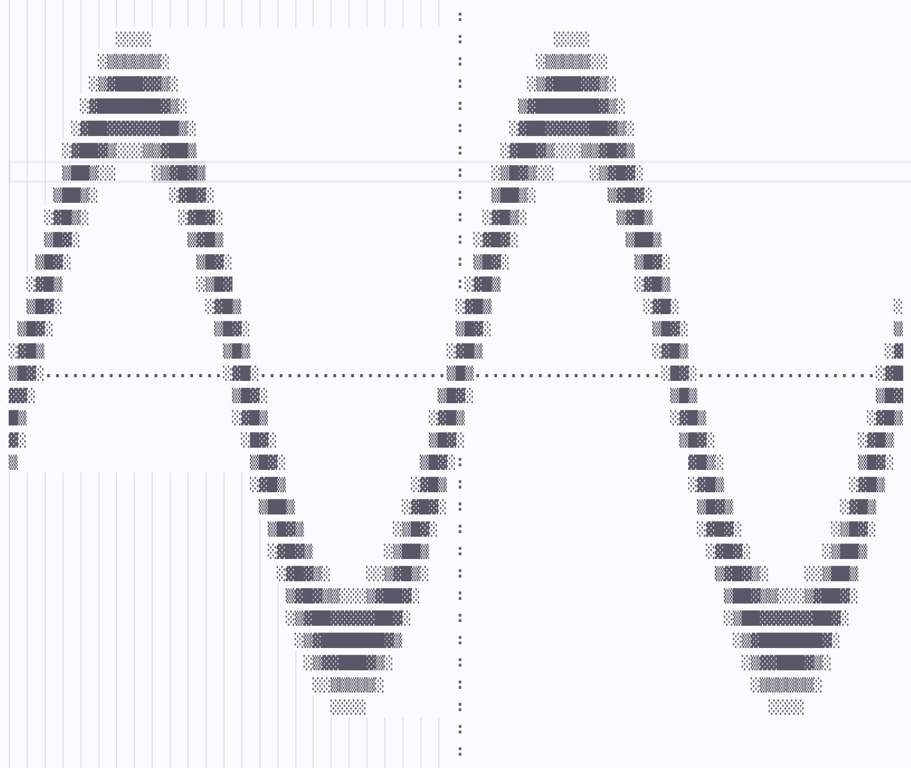

# UniPlot

# Introduction
An experimental text-based graph plotter. The function drawn is defined in the source code. The dimensions of the graph, scaling, and line boldness can all be adjusted.

**For text examples, please see the 'examples' folder.**

# Improvements
- Currently square-roots cannot be drawn correctly, with the plotter only drawing the positive root.
- Functions have to be hard coded. A LATeX parser would be a welcome addition.
